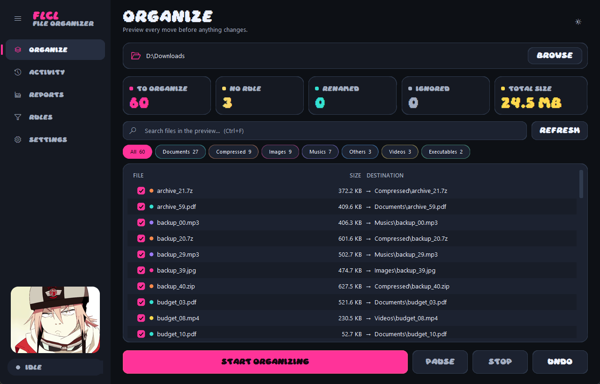
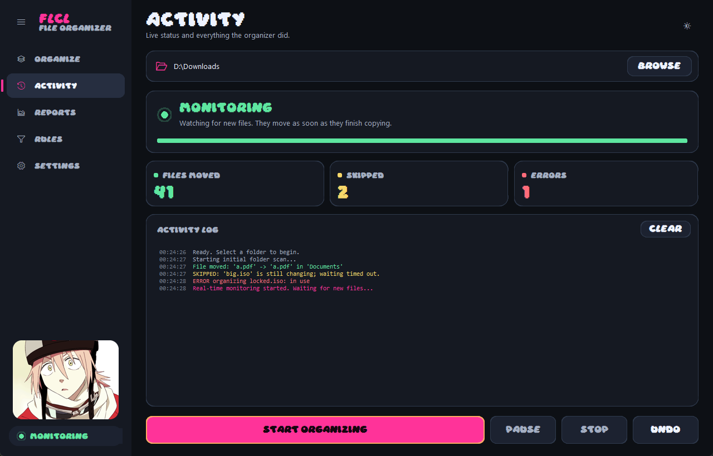
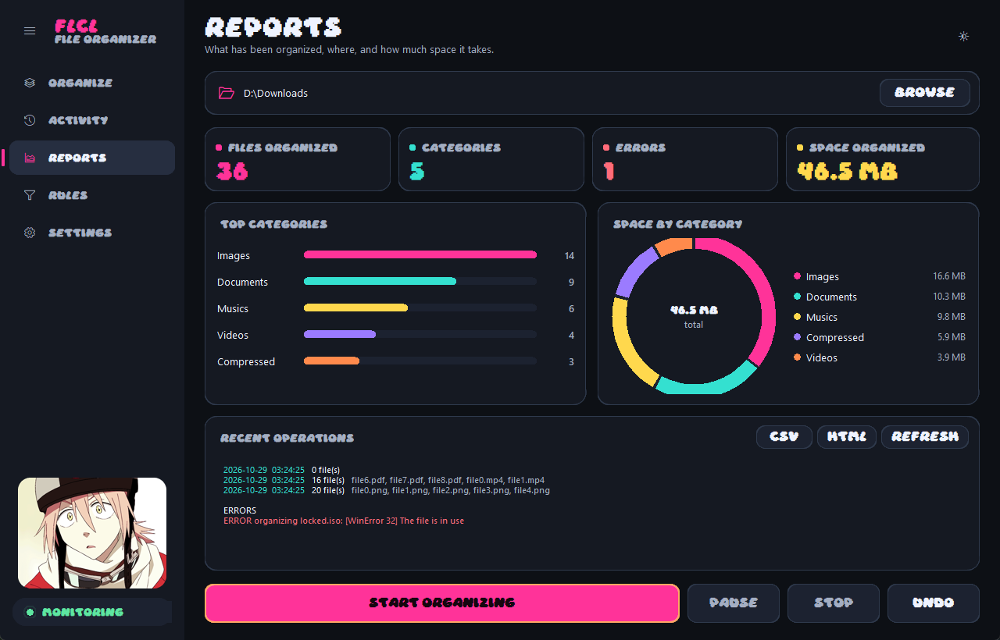
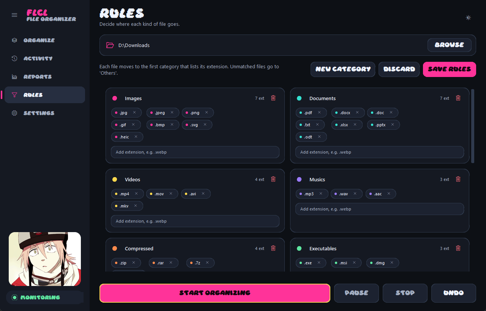
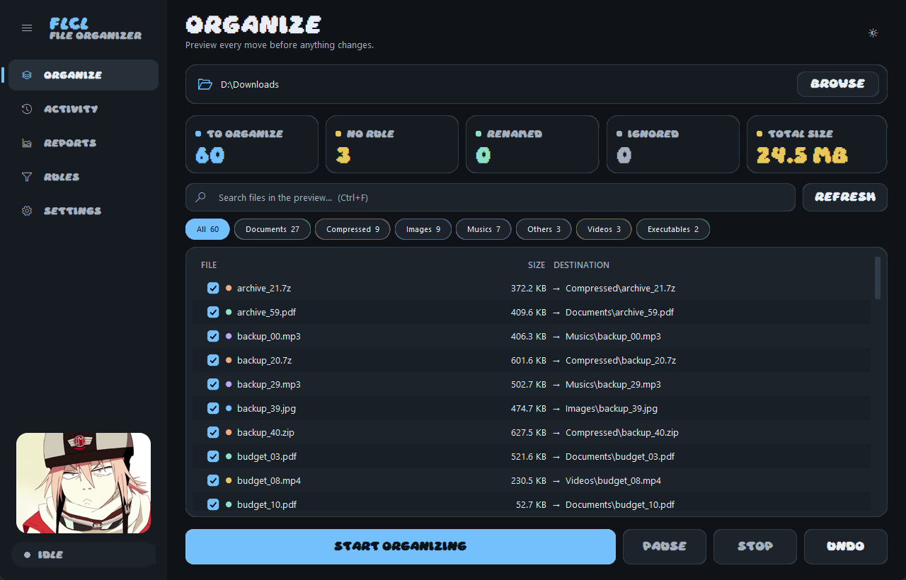

<p align="center">
  
</p>

<h1 align="center">FLCL FILE ORGANIZER</h1>

<p align="center"><strong>Automatic file organization with a preview-first workflow</strong></p>

<p align="center">Classify, monitor, and clean up your folders without losing control of where your files go.</p>

<p align="center">
  
  
  
  
  
</p>

<p align="center">
  
</p>

<p align="center"><em>Inspired by FLCL. Designed for dependable everyday file management.</em></p>

---

## Safety and behavior

FLCL File Organizer moves files on your behalf. Always review the preview before starting a new folder and avoid pointing it at directories containing applications or files that must remain in place.

- The preview does not change files on disk.
- Existing destination files are never overwritten.
- Name conflicts receive a unique suffix such as `report (1).pdf`.
- Files are checked for stability before they are moved, reducing races with active downloads and copies.
- Recursive organization is opt-in and asks for confirmation before starting.
- Undo restores the most recent organization run when the original path is still available.

This tool is intended for files and folders you own or are authorized to manage.

## About

FLCL File Organizer is a Windows desktop utility that turns a folder into a monitored, rule-driven workspace. It can organize files already present in a directory and continue watching for new files in the background.

The application uses a preview-first workflow: before any move occurs, it builds a destination plan and reports the number of files to organize, files without a matching rule, conflicts, and ignored items. This keeps automation visible.

The interface is built to be a pleasure to look at: a hot-pink FLCL identity set in the Daydream display face, a sidebar with a gliding page indicator, cards whose numbers count up, a status light that ripples while the organizer works, and a Haruko who speeds up when files move. A dark neutral theme offers the same layout and contrast with a quieter palette.

## Capabilities

### File organization

- Organize existing files during the initial scan.
- Monitor a folder continuously with `watchdog`.
- Classify files by simple or compound extensions such as `.pdf`, `.jpg`, and `.tar.gz`.
- Send unmatched extensions to the `Others` category.
- Wait for files to become stable before moving them.
- Resolve destination collisions with unique names instead of overwriting.

### Preview and control

- Review the complete destination plan before starting, even for folders with thousands of files.
- Uncheck individual files (or press Space on selected rows) to leave them where they are.
- Search the plan and filter it by destination category.
- Drag a folder from Explorer onto the window to preview it.
- See live summary counts for files to organize, missing rules, conflicts, ignored files, and total size.
- Pause and resume monitoring without closing the application.
- Stop the current monitoring session cleanly.
- Undo the most recent organization run using recorded move history.

### Rules and filters

- Create custom categories and map extensions to destination folders.
- Support compound extensions through longest-match detection.
- Ignore hidden files by default.
- Exclude extensions, filename patterns, and folders.
- Ignore files below a configurable minimum size.
- Include subfolders through an explicit recursive mode.
- Edit categories, extensions, and filters visually from the Rules page, with validation for folder names Windows cannot create.

### Reports and Windows integration

- Generate reports containing organized files, popular categories, errors, space usage, and recent history, with animated charts.
- Export reports as CSV or as a styled, standalone HTML page.
- Show Windows notifications when files are organized while monitoring.
- Start automatically with Windows.
- Minimize to the system tray.
- Remember the last selected folder.
- Choose between the FLCL dark theme and the dark neutral theme.
- Use the full interface in a smaller, non-maximized window.

## Interface

A sidebar switches between five pages (`Ctrl+1` to `Ctrl+5`):

| Page | Purpose |
|---|---|
| **Organize** | Pick or drop a folder, search and filter the plan, check or uncheck files, and read the summary cards. |
| **Activity** | Follow the live status, scan progress, counters, and the color-coded operation log. |
| **Reports** | See totals, top categories, space by category, recent runs, and export the report. |
| **Rules** | Edit categories and extensions as chips, plus ignored extensions, patterns, folders, and minimum size. |
| **Settings** | Behavior switches, theme picker, reduce motion, and keyboard shortcuts. |

`Start`, `Pause`, `Stop`, and `Undo` live in one action bar at the bottom of every page. Below 1060 px wide the sidebar collapses to icons, and Haruko steps aside on short windows.

<p align="center">
  
  
  
  
</p>

### Appearance and animations

Every color, radius, spacing step, and duration comes from one set of design tokens (`src/ui/theme.py`), so both themes stay consistent and every text color is tested to meet WCAG AA contrast. One tween engine (`src/ui/anim.py`) drives all motion from a single Tk timer:

- the window fades in, and the theme switch fades the window out and back;
- pages slide in while the sidebar indicator glides to the active item;
- buttons fade their color on hover, and `Start` pulses a few times when there is something to organize;
- summary and report numbers count up, report bars grow in sequence, and the space donut sweeps open;
- the first rows of a new preview cascade in;
- toasts slide in from the corner and restack as they leave;
- the status light ripples while scanning or monitoring, and Haruko speeds up while files move.

Turn on **Settings > Reduce motion** (or switch off Windows animation effects) to make every transition instant and keep the GIF still.

## Organization workflow

```text
[Choose a folder]
        │
        ├─► Load rules and filters
        │
        ├─► Build a non-destructive preview
        │      ├─ Files to organize
        │      ├─ Files without a matching rule
        │      ├─ Name conflicts
        │      └─ Ignored files
        │
        ├─► Review destination plan
        │
        ├─► Start initial scan
        │
        ├─► Monitor new files in real time
        │      ├─ Wait for file stability
        │      ├─ Resolve destination conflicts
        │      └─ Record every successful move
        │
        └─► Stop, pause, report, or undo the latest run
```

## Installation

### Ready-to-use Windows build

1. Open the [Releases page](https://github.com/shwdaniel7/FLCL-File-Organizer/releases).
2. Download the latest `FLCL_File_Organizer.zip` package.
3. Extract the archive.
4. Run `FLCL_File_Organizer.exe`.

The packaged version includes Python and the required dependencies.

### Run from source

Requirements:

- Windows 10 or newer
- Python 3.10 or newer

```powershell
git clone https://github.com/shwdaniel7/FLCL-File-Organizer.git
Set-Location FLCL-File-Organizer

python -m venv .venv
.\.venv\Scripts\Activate.ps1
pip install -r requirements.txt
python app.py
```

> PowerShell may require an execution-policy adjustment in some environments. Use the policy appropriate for your machine and organization.

## Rules and configuration

Rules are edited on the **Rules** page. Each category is a card: rename it in place, type an extension and press Enter to add it as a chip, or click a chip's `×` to remove it. Extensions are normalized (`PNG` becomes `.png`), and an extension can belong to only one category. Category names become folders, so names Windows cannot create (`CON`, `a/b`, `what?`, a trailing dot) are rejected.

Files move to the first category that lists their extension, and compound extensions such as `.tar.gz` win over `.gz`. Unmatched files go to `Others`.

The **Filters** card keeps files where they are:

- ignored extensions, such as `.tmp`, `.bak` or `.crdownload`;
- ignored name patterns, such as `*.part` or `~$*`;
- ignored folders (with subfolders on), such as `Temp` or `node_modules`;
- hidden files;
- files smaller than a minimum size in KB.

Edits stay in a draft, marked **UNSAVED**, until you press **Save rules**. Saving refreshes the preview and reports how many files will move now. **Discard** returns to the saved rules.

### Settings persistence

The application stores user settings and move history in the per-user Windows application data area. This prevents the app from depending on its current working directory and keeps preferences available between launches.

When no user configuration exists yet, the bundled `config.json` is used as the initial configuration. The selected folder, theme, recursive mode, notifications, autostart, and tray preferences are retained.

## Preview, reports, and undo

The preview summarizes the current plan without moving anything. A planned destination may include the `RENAME` marker when a collision is detected, while `NO RULE` identifies files that will be sent to the fallback category.

The **Reports** page includes:

- total files organized;
- most frequently used categories;
- recorded errors;
- space occupied by category;
- recent organization history.

**Undo** asks for confirmation, then uses the recorded source and destination paths from the latest run. If the destination file no longer exists, or the original path has since been occupied by another file, that item is skipped and the reason is logged instead of overwriting anything.

## Project structure

```text
FLCL-File-Organizer/
├── app.py                  Application entrypoint
├── config.json             Bundled default rules
├── requirements.txt        Runtime dependencies
├── assets/                 Daydream font, Haruko GIF, icons, screenshots
├── src/
│   ├── organizer.py        Rules, preview, movement, history, monitoring, reports
│   ├── report_export.py    CSV and HTML report rendering
│   ├── gui.py              App state, actions, worker messages, layout shell
│   └── ui/
│       ├── theme.py        Design tokens and the CustomTkinter theme built from them
│       ├── anim.py         Tween engine, easings, color interpolation
│       ├── widgets.py      Animated buttons, cards, toasts, chips, sidebar, dialogs
│       ├── tray.py         System tray icon
│       ├── autostart.py    Start-with-Windows registry entry
│       └── pages/          Organize, Activity, Reports, Rules, Settings
└── tests/                  Organizer, export, theme, animation and GUI smoke tests
```

The UI and the organizer engine stay separate. Monitoring and undo run off the UI thread and queue their log messages back to it. All UI state (preview, exclusions, search, log, counters) lives in `AppGUI`, not in widgets, so a theme switch can rebuild the whole interface without losing anything.

## Development

Run the lint, tests, and compile check from the repository root:

```powershell
pip install ruff
ruff check .
python -m unittest discover -s tests -v
python -m compileall src
```

The suite covers classification, moves, preview, history, undo, monitoring, settings, reports and their CSV/HTML export, rule validation, the tween engine, theme contrast, and a GUI smoke test. The smoke test builds every page and switches theme, and skips itself when no display is available.

## Build a Windows executable

Install PyInstaller inside the active virtual environment:

```powershell
pip install pyinstaller
```

Then build the application with its runtime assets:

```powershell
pyinstaller --name "FLCL_File_Organizer" --onefile --windowed --icon="assets/icon.ico" --add-data "assets;assets" --add-data "config.json;." --collect-all customtkinter --collect-all tkinterdnd2 app.py
```

The executable is written to `dist/`. `--add-data` bundles the font, GIF, icons, and default configuration. `--collect-all` brings in the CustomTkinter themes and the native drag-and-drop library.

## Technology stack

- **Python 3** - application runtime and file-management logic.
- **CustomTkinter** - dark desktop interface and responsive layout.
- **Watchdog** - filesystem event monitoring.
- **Pillow** - animated GIF and image loading.
- **Pystray** - system tray integration.
- **Winotify** - Windows notifications.
- **tkinterdnd2** - drag a folder onto the window (optional at runtime).
- **JSON** - rules, preferences, move history, and report data.
- **PyInstaller** - standalone Windows packaging.

## Changelog

### Redesign

- New interface: sidebar navigation, five pages, one action bar, collapsible layout, and empty states.
- Design tokens and a generated CustomTkinter theme, so every widget follows the active palette.
- One animation engine for hover fades, page slides, count-ups, cascades, toasts, charts, and status pulses, with Reduce motion.
- Preview list rebuilt on a styled tree view: thousands of rows, search, category filters, and checkboxes.
- Visual rules editor with validation, replacing the plain-text editor.
- Reports page with animated charts; HTML export now escapes file names and errors.
- Drag-and-drop folders, in-app toasts, and styled confirmation dialogs (Undo now asks first).
- Faster previews for large folders: the conflict check no longer rebuilds its lookup for every file.
- Stopping while paused no longer risks hanging the watcher.
- CI runs `ruff`, and new tests cover theme contrast, animation, export escaping, rule validation, and a GUI smoke test.

## License

This project is licensed under the MIT License.
